# Citadel — End-to-End IT/OT Simulation Sandbox

A 4-PC portfolio lab that simulates a helium-cooled reactor plant and moves its telemetry up the Purdue Model — field protocols (**Modbus TCP**, **OPC UA**) → operator HMI (**FactoryTalk Optix**) → **MQTT** → across a **Level 3.5 firewall** → **TimescaleDB + Grafana** — with zero-touch `git push` deployment to every node.

```mermaid
flowchart LR
    subgraph PC2["PC #2: Citadel Plant Floor (L0–1 • Air-Gapped OT 10.10.0.10) [Sprint 2 - Complete]"]
        direction TB
        SIM["Helium-Cooled Reactor Simulator<br/>Vault & Control Room Radiation Zones<br/>Fault Trigger"]
        PLC["Virtual PLC (Unit-Suffixed Tags)<br/>Modbus :502 | OPC UA :4840"]
        SIM --> PLC
    end

    subgraph PC3["PC #3: Citadel Control Room (L2–3 • Air-Gapped OT 10.10.0.20) [Sprints 3–4]"]
        direction TB
        HMI["FactoryTalk Optix HMI"]
        GW["OT Gateway<br/>(Modbus → MQTT)"]
        MQ["Mosquitto MQTT (:1883)"]
        GW --> MQ
    end

    FW{{"Level 3.5 Boundary = PC #4 OT NIC 10.10.0.30<br/>IP forwarding OFF • host firewall"}}

    subgraph PC4["PC #4: Enterprise IT & Analytics (L4 • Dual-NIC 192.168.1.244 / 10.10.0.30) [Sprints 3–4]"]
        direction TB
        ING["Ingestion Worker<br/>(MQTT → TimescaleDB)"]
        TSDB[("TimescaleDB (:5432)")]
        GRAF["Grafana Dashboards (:3000)"]
        ING --> TSDB --> GRAF
    end

    PLC -->|"OPC UA :4840"| HMI
    PLC -->|"Modbus TCP :502"| GW
    MQ -->|"MQTT :1883 (PC #4 subscribes)"| FW --> ING
```



## Lab Topology

| PC | Role | Purdue | Network | Runs |
|----|------|--------|---------|------|
| #1 | Dev & CI Workstation | — | Corp LAN 192.168.1.177 | VS Code, Claude Code, pytest, Git |
| #2 | Citadel Plant Floor | L0–1 | Air-gapped OT 10.10.0.10 | Reactor simulator, Virtual PLC (Modbus :502, OPC UA :4840) |
| #3 | Citadel Control Room | L2–3 | Air-gapped OT 10.10.0.20 | FactoryTalk Optix HMI, OT gateway, Mosquitto (:1883) |
| #4 | Enterprise IT & Analytics | L4 | Dual-NIC 192.168.1.244 + 10.10.0.30 | Ingestion worker, TimescaleDB (:5432), Grafana (:3000), Actions runner / jump-host |

Diagram: [`docs/architecture.md`](docs/architecture.md) · Network & firewall: [`docs/network.md`](docs/network.md) · Tag map: [`docs/tag-map.md`](docs/tag-map.md) · Compliance & interview guide: [`docs/compliance-and-interview-guide.md`](docs/compliance-and-interview-guide.md) · Plan: [`agile/backlog.md`](agile/backlog.md) · Latest sprint: [`agile/sprint-02.md`](agile/sprint-02.md)

## Build Progress

* **Sprint 1 — Foundation, Topology & Pipeline** *(Complete)*: 4-PC Purdue topology, firewall baseline, CI pipeline and backlog.
* **Sprint 2 — Containerized Plant Floor & Virtual PLC (PC #2)** *(Complete)*: coupled reactor physics (power → core temperature → helium pressure), physical radiation zones (vault ~1.5 µSv/h rising to 25–80 µSv/h on a fault, control room steady at ~0.20 µSv/h) and a fault trigger, served as unit-suffixed tags over **Modbus TCP (`:502`)** and **OPC UA (`:4840`)** from the same PLC scan. Shipped as a non-root, read-only container, built and smoke-tested in CI and published to `ghcr.io` pinned by SHA-256 digest; `plant_probe` verifies both protocols agree.
* **Sprint 3 — Control Room Gateway & Enterprise Ingestion (PC #3 → PC #4)** *(Next)*: OT gateway polling Modbus and publishing to Mosquitto MQTT, the MQTT schema, and the PC #4 ingestion worker writing to TimescaleDB across the Level 3.5 boundary.
* **Sprint 4 — Operator HMI, Dashboards & Zero-Touch Deployment** *(Planned)*: FactoryTalk Optix screens over OPC UA, Grafana dashboards as code, and the single self-hosted runner on dual-NIC PC #4 deploying into the air-gapped OT LAN (`US-406`).
* **Sprints 5–6 — Alarms, Scenarios, Hardening & Live Demo** *(Planned, MVP Dec 31, 2026)*.

## Quick Start (PC #1)

```powershell
git clone https://github.com/dsl7-max/smr-it-ot-telemetry-sim.git
cd smr-it-ot-telemetry-sim
python -m venv .venv; .\.venv\Scripts\Activate.ps1
pip install -r requirements-dev.txt
pytest
```

Run the plant container locally (short-lived; PC #1 hosts no long-lived services) and compare both protocols:

```powershell
docker compose -f deploy/docker-compose.plant.yml up -d --build --wait
python -m simulators.plant_probe --host localhost          # add --trigger-fault / --clear-fault
docker compose -f deploy/docker-compose.plant.yml down
```

## Deployment

Pushing to `main` runs `.github/workflows/deploy.yml`. On a GitHub-hosted runner it runs pytest, builds the plant container, smoke-tests it over both protocols, and publishes that exact image to `ghcr.io`, pinned by SHA-256 digest. The single self-hosted runner on dual-NIC PC #4 then deploys its own stack locally. It pulls the OT images by digest and moves them into the air-gapped OT LAN with `docker save | docker load` over SSH (PC #3 directly, PC #2 via ProxyJump through PC #3). Deploys are gated by the `RUNNERS_READY` repo variable until that runner is live (US-406). To run one stack by hand, copy `deploy/.env.example` to `deploy/.env` and run `docker compose -f deploy/<file>.yml --env-file deploy/.env up -d`.

---

**Author:** David LeClear Sr. — Systems Architect & Full-Stack Software Engineer ([2-Page Resume (PDF)](docs/David-LeClear-Sr-Resume.pdf))
