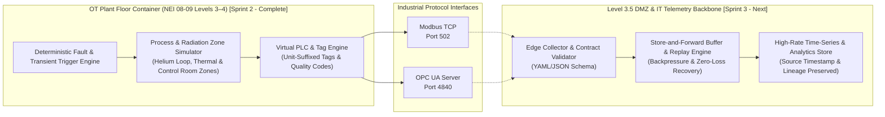

# SMR IT/OT Telemetry & Plant Floor Simulation (`smr-it-ot-telemetry-sim`)

An end-to-end industrial telemetry reference architecture and containerized simulation testbed modeling high-rate plant-floor instrumentation, deterministic protocol exposure, and resilient IT/OT data ingestion across regulated security boundaries (NEI 08-09 / Purdue Model).

---

## Architecture Overview



---

## Key Engineering Design Principles

* **Explicit Engineering Units in Tag Contracts:** All exposed registers and nodes follow strict unit-suffixed naming conventions (e.g., `_kpa`, `_degc`, `_mrem_hr`, `_kg_s`) paired with source timestamps and OPC UA quality flags to eliminate unit-conversion ambiguity downstream.
* **Dual-Protocol Deterministic Exposure:** Exposes identical plant state simultaneously over **Modbus TCP (Port 502)** for legacy register-level polling and **OPC UA (Port 4840)** for structured namespace browsing and subscription telemetry.
* **Built-In Transient & Fault Injection:** Supports programmatic fault triggers (sensor drift, zone radiation spikes, communication dropouts) to validate downstream alarm handling, backpressure, and replay behavior under abnormal operating conditions.
* **Supply-Chain & Container Discipline:** Plant floor simulation and virtual PLC runtime are packaged as a single reproducible container built on **SHA-256 digest-pinned** base images for deterministic builds and offline portability.

---

## Project Roadmap & Status

### Sprint 1 — Core Telemetry Engine & Protocol Scaffolding *(Complete)*
* Multi-threaded simulation loop generating deterministic 1-second sensor ticks.
* Initial Modbus TCP register mapping and OPC UA node tree structure.

### Sprint 2 — Containerized Plant Floor & Fault Injection *(Complete)*
* Unified Plant Floor + Virtual PLC runtime packaged into a single digest-pinned Docker container.
* Added control room and process radiation zone modeling alongside programmatic fault triggers.
* Standardized all telemetry endpoints to unit-suffixed tag names across **Modbus TCP (`502`)** and **OPC UA (`4840`)**.
* Verified end-to-end container build and protocol smoke tests.

### Sprint 3 — Level 3.5 Buffering, Replay & IT Ingestion *(In Progress)*
* Unidirectional edge collector enforcing contract-first YAML/JSON schema validation.
* Persistent local ring-buffer with automatic store-and-forward replay during simulated Level 3.5 link outages.
* High-rate time-series ingestion pipeline preserving source timestamps, packet ordering, and end-to-end lineage.

---

## Quick Start (Plant Floor Container)

### Prerequisites
* Docker Engine 24+ (or Docker Desktop)

### Build & Run
```bash
# Clone the repository
git clone https://github.com<your-username>/smr-it-ot-telemetry-sim.git
cd smr-it-ot-telemetry-sim

# Build and start the containerized Plant Floor (Simulator + Virtual PLC)
docker compose up --build -d

# Verify active Modbus TCP (502) and OPC UA (4840) listeners
docker ps
```

### Exposed Endpoints

| Protocol | Port | Purpose |
| :--- | :--- | :--- |
| **Modbus TCP** | `502` | Holding/Input registers for raw PLC telemetry polling & fault state triggers |
| **OPC UA** | `4840` | Structured industrial object model with unit-suffixed tags, timestamps & quality codes |

---

## Repository Structure

```text
smr-it-ot-telemetry-sim/
├── agile/                  # Sprint backlogs, user stories (US-101..207), and acceptance criteria
├── plant-floor/            # Unified simulator + virtual PLC runtime & Dockerfile (digest-pinned)
├── configs/                # Tag maps (Modbus register vs. OPC UA NodeID) & zone definitions
├── tests/                  # Automated protocol smoke tests & fault-trigger verification
└── README.md               # Architecture overview and quick-start guide
```

---

## Author
**David LeClear Sr.** — Principal Systems & Telemetry Architect  
*38+ years architecting high-rate C/OCI time-series ingestion engines, carrier-grade streaming backbones, and hardware-to-software systems.*
