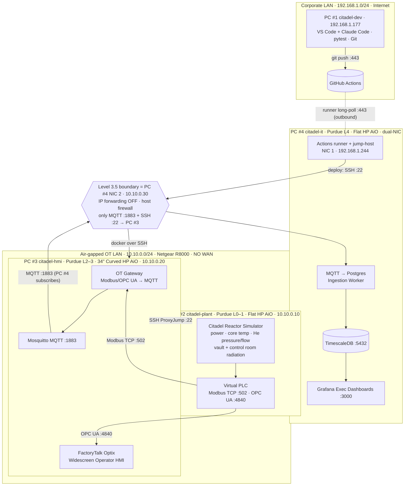

# Citadel Architecture — 4-PC Purdue Model (Dual-NIC L4 + Air-Gapped OT)

> Keep this file in sync with `/deploy/*.yml` (ports, containers, images). Network detail and firewall policy: [`network.md`](network.md).

## Topology Diagram

## Node & Port Inventory

| PC | Hostname / IP | Purdue | Compose file | Deployed by | Service | Port | Status |
|----|---------------|--------|--------------|-------------|---------|------|--------|
| #1 Dev & CI | `citadel-dev` · 192.168.1.177 | — | — | — | VS Code, Claude Code, Git | — | Active |
| #2 Citadel Plant | `citadel-plant` · 10.10.0.10 | L0–1 | `docker-compose.plant.yml` | PC #4 → SSH ProxyJump via PC #3 | **citadel-plant** container `plant-virtual-plc`, image `citadel/plant` (`simulators/Dockerfile`, base `python:3.12.16-slim-trixie@sha256:5e2b…`). One process: reactor model (`simulators/citadel_reactor.py`) + Virtual PLC serving Modbus TCP and OPC UA (`opc.tcp://…:4840/citadel/plant`) from one latched scan; map in [`tag-map.md`](tag-map.md). Non-root (uid 10001), read-only rootfs, all capabilities dropped, HEALTHCHECK on both ports, no volumes | 502/tcp → container 5020; 4840/tcp | Containerized (US-204); built + smoke-tested in CI, published to ghcr.io by digest (US-206) |
| #3 Control Room | `citadel-hmi` · 10.10.0.20 | L2–3 | `docker-compose.control-room.yml` | PC #4 → SSH | mosquitto (`eclipse-mosquitto:2.0.20@sha256:2142…`) | 1883/tcp | Scaffolded |
| | | | | | ot-gateway | — | Planned (Sprint 2–3) |
| | | | | (manual) | FactoryTalk Optix (native Windows) | — | Planned (Sprint 4) |
| #4 Enterprise IT | `citadel-it` · 192.168.1.244 (NIC 1) / 10.10.0.30 (NIC 2) | L4 | `docker-compose.enterprise-it.yml` | PC #4 runner (local) | timescaledb (`2.17.2-pg16@sha256:4e45…`) | 5432/tcp | Scaffolded |
| | | | | | grafana (`grafana-oss:11.3.0@sha256:a0f8…`) | 3000/tcp | Scaffolded |
| | | | | | it-ingestion | — | Planned (Sprint 3) |
| #4 Enterprise IT | | — | — | — | GitHub Actions self-hosted runner (`self-hosted, windows, enterprise-it`) | outbound 443 | Planned (US-406) |

## Data Flow

1. **L0–1 (PC #2):** Reactor simulator generates telemetry; Virtual PLC exposes it as Modbus registers and OPC UA nodes.
2. **L2–3 (PC #3):** OT Gateway polls PC #2 over Modbus TCP and publishes to the local Mosquitto broker; FactoryTalk Optix HMI reads PC #2 over OPC UA.
3. **L3.5 (PC #4 NIC 2):** PC #4 initiates the only data connection into OT — an MQTT subscription to `10.10.0.20:1883`. IP forwarding is disabled, so PC #4 never routes between networks; PC #4 ↔ PC #2 is blocked at both ends.
4. **L4 (PC #4):** Ingestion worker writes to TimescaleDB hypertables; Grafana serves dashboards to the corporate LAN on :3000.

## CI/CD Flow

`git push` (PC #1) → GitHub Actions `test` job (pytest, GitHub-hosted) → on pass, deploy jobs run on the **single self-hosted runner on PC #4**:
- **Enterprise IT:** local `docker compose up -d --build`.
- **Plant image:** built from the compose file, smoke-tested (both protocols, non-root, read-only) and, on `main`, pushed as-is to private `ghcr.io/<owner>/citadel-plant:sha-<commit>` with the `GITHUB_TOKEN`; the job summary prints the digest-pinned `PLANT_IMAGE` ref.
- **Control Room / Plant:** images pulled by digest on PC #4 (plant from ghcr.io), streamed via `docker save | ssh … docker load`, then `docker compose up --pull never` against a remote `DOCKER_HOST=ssh://…` (Plant reached via ProxyJump through PC #3).

Deploy jobs are gated by repo variable `RUNNERS_READY` until US-406. Details: [`network.md` §6](network.md#6-deployment-path--pc-4-as-jump-host--runner).
