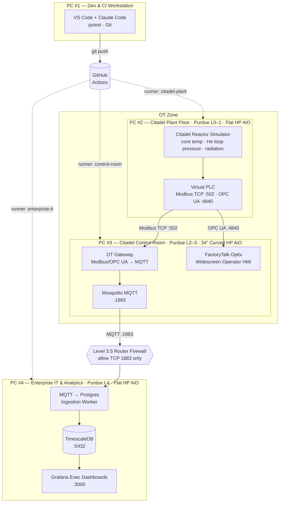

# Citadel Architecture — 4-PC Purdue Model

> Keep this file in sync with `/deploy/*.yml` (ports, containers, images). See `CLAUDE.md` §3.

## Topology Diagram

## Node & Port Inventory

| PC | Purdue Level | Runner labels | Compose file | Service | Port | Status |
|----|--------------|---------------|--------------|---------|------|--------|
| #1 Dev & CI | — | — (GitHub-hosted `ubuntu-latest` runs pytest) | — | VS Code, Claude Code, Git | — | Active |
| #2 Citadel Plant | L0–1 | `self-hosted, windows, citadel-plant` | `docker-compose.plant.yml` | citadel-reactor-sim (`simulators/citadel_reactor.py`) | — | Code built (US-103); container in US-204 |
| | | | | virtual-plc | 502/tcp, 4840/tcp | Planned (Sprint 2) |
| #3 Control Room | L2–3 | `self-hosted, windows, control-room` | `docker-compose.control-room.yml` | mosquitto (`eclipse-mosquitto:2.0.20`) | 1883/tcp | Scaffolded |
| | | | | ot-gateway | — | Planned (Sprint 2–3) |
| | | | | FactoryTalk Optix (native Windows) | — | Planned (Sprint 4) |
| #4 Enterprise IT | L4 | `self-hosted, windows, enterprise-it` | `docker-compose.enterprise-it.yml` | timescaledb (`2.17.2-pg16`) | 5432/tcp | Scaffolded |
| | | | | grafana (`grafana-oss:11.3.0`) | 3000/tcp | Scaffolded |
| | | | | it-ingestion | — | Planned (Sprint 3) |

## Data Flow

1. **L0–1 (PC #2):** Reactor simulator generates telemetry; Virtual PLC exposes it as Modbus registers and OPC UA nodes.
2. **L2–3 (PC #3):** OT Gateway polls PC #2 over Modbus TCP and publishes to the local Mosquitto broker; FactoryTalk Optix HMI reads PC #2 over OPC UA.
3. **L3.5 Firewall:** Only MQTT (TCP 1883) between PC #3 and PC #4 is permitted. No direct L4 → L0–1 path.
4. **L4 (PC #4):** Ingestion worker subscribes to PC #3's broker, writes to TimescaleDB hypertables; Grafana visualizes.

## CI/CD Flow

`git push` (PC #1) → GitHub Actions `test` job (pytest) → on pass, matrix `deploy` job fans out to the three self-hosted runners, each running `docker compose up -d --build` for its own compose file.
