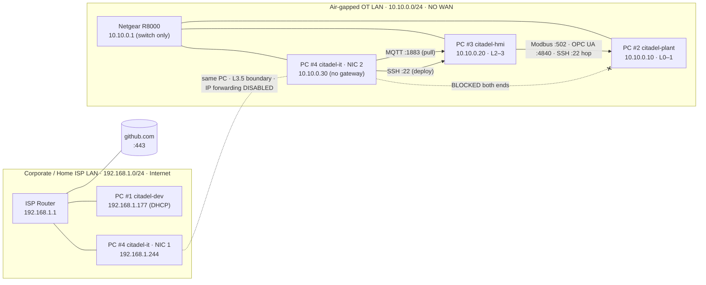

# Citadel Network — Dual-NIC Level 4 + Air-Gapped OT

> Source of truth for addressing, conduits, and firewall policy. Enforced by `deploy/setup-firewall.ps1`.
> Keep in sync with any port or rule change (see `CLAUDE.md` §3).

## 1. Design Principles

1. **The OT network is air-gapped.** The Netgear R8000 (`10.10.0.1`) has **no WAN cable** — PCs #2 and #3 have zero Internet access.
2. **PC #4 is the only bridge, and it does not route.** It is dual-homed (corporate NIC + OT NIC) with IPv4 forwarding, IP routing, ICS, and RRAS all disabled, and **no default gateway on its OT NIC**. Nothing can transit PC #4 between `192.168.1.0/24` and `10.10.0.0/24`.
3. **One data conduit across Level 3.5:** PC #4 → PC #3 on MQTT TCP 1883. PC #4 never talks to PC #2.
4. **Deny-by-default, both ends.** Each flow is blocked at the source *and* the destination host firewall, so a gap on one side is not a breach.
5. **OT never initiates into IT.** All L3.5 connections originate from PC #4 (pull model).

> **Honest caveat (portfolio note):** A dual-homed host is a lab compromise, not a true IEC 62443 / Purdue L3.5 DMZ. In production this role would be a dedicated firewall pair or data diode with a DMZ broker. Here L3.5 is enforced by host firewalls + disabled forwarding on a flat OT /24 — documented as such and listed in the backlog Icebox.

## 2. Topology



## 3. Address Plan

| PC | Hostname | Purdue | NIC | IP / Mask | Gateway | Internet | Notes |
|----|----------|--------|-----|-----------|---------|----------|-------|
| #1 | `citadel-dev` | — (Dev & CI) | Ethernet/Wi-Fi | `192.168.1.177/24` (DHCP) | `192.168.1.1` | Yes | **Create a DHCP reservation** — firewall rule on PC #4 trusts this IP for Postgres. |
| #4 | `citadel-it` | L4 | NIC 1 — Corporate IT | `192.168.1.244/24` static | `192.168.1.1` | Yes | GitHub runner, jump-host, Grafana for viewers. |
| #4 | `citadel-it` | L3.5 boundary | NIC 2 — OT Ingestion | `10.10.0.30/24` static | **none (leave blank)** | No | A gateway here would create a second default route. |
| #3 | `citadel-hmi` | L2–3 | Ethernet | `10.10.0.20/24` static | `10.10.0.1` (optional) | No | FactoryTalk Optix, Mosquitto, OT gateway. |
| #2 | `citadel-plant` | L0–1 | Ethernet | `10.10.0.10/24` static | `10.10.0.1` (optional) | No | Reactor simulator + Virtual PLC. |
| — | Netgear R8000 | — | LAN | `10.10.0.1/24` | — | **No WAN** | Acts as an OT switch. |

**R8000 hardening checklist:** WAN port unplugged · DHCP scope kept clear of `.10–.30` (or DHCP off) · **Wi-Fi radios disabled** (a wireless client would bypass the cabled air gap) · admin password changed · remote management off · UPnP off.

**DNS:** the OT LAN has no DNS. Code and compose files use IPs via env vars (`PLANT_HOST=10.10.0.10`, `CONTROL_ROOM_HOST=10.10.0.20`); optional `hosts` file entries for humans.

## 4. Flow Matrix (allowed = explicit; everything else denied)

| # | Source | Destination | Port/Proto | Purpose | Verdict | Enforced by |
|---|--------|-------------|------------|---------|---------|-------------|
| F1 | PC #1 `192.168.1.177` | github.com | 443/TCP | `git push` | Allow | default outbound |
| F2 | PC #4 `192.168.1.244` | github.com | 443/TCP | Actions runner long-poll (outbound only) | Allow | default outbound |
| F3 | `192.168.1.0/24` | PC #4 `192.168.1.244` | 3000/TCP | Grafana dashboards | Allow | PC #4 inbound rule |
| F4 | PC #1 `192.168.1.177` | PC #4 `192.168.1.244` | 5432/TCP | SQL from dev box | Allow | PC #4 inbound rule |
| F5 | PC #4 `10.10.0.30` | PC #3 `10.10.0.20` | 1883/TCP | MQTT subscribe (L3.5 data conduit) | Allow | PC #3 inbound rule |
| F6 | PC #4 `10.10.0.30` | PC #3 `10.10.0.20` | 22/TCP | Deploy via SSH (Docker remote) | Allow | PC #3 inbound rule |
| F7 | PC #3 `10.10.0.20` | PC #2 `10.10.0.10` | 502/TCP | Modbus TCP poll (OT gateway) | Allow | PC #2 inbound rule |
| F8 | PC #3 `10.10.0.20` | PC #2 `10.10.0.10` | 4840/TCP | OPC UA (FactoryTalk Optix) | Allow | PC #2 inbound rule |
| F9 | PC #3 `10.10.0.20` | PC #2 `10.10.0.10` | 22/TCP | Deploy hop (SSH ProxyJump from PC #4) | Allow | PC #2 inbound rule |
| X1 | PC #4 `10.10.0.30` | PC #2 `10.10.0.10` | **any** | L4 must never reach L0–1 | **Block** | PC #4 outbound + PC #2 inbound |
| X2 | PC #2 `10.10.0.10` | PC #4 `10.10.0.30` | **any** | L0–1 must never reach L4 | **Block** | PC #2 outbound + PC #4 inbound |
| X3 | `10.10.0.0/24` | PC #4 (any IP) | **any** | OT never initiates into IT | **Block** | PC #4 inbound |
| X4 | PC #4 `10.10.0.30` | `10.10.0.0/24` except `.20` | **any** | PC #4 talks only to PC #3 on OT side | **Block** | PC #4 outbound |
| X5 | `192.168.1.0/24` ↔ `10.10.0.0/24` | — | **routed** | No transit through PC #4 | **Impossible** | forwarding off, no OT gateway |

## 5. Host Firewall Rules (Windows Defender, group `Citadel`)

Applied by `deploy/setup-firewall.ps1 -Role <Role>`. Block rules take precedence over Allow rules in Windows Firewall, so they also override broad rules added by Docker Desktop or FactoryTalk installers. All rules use `-Profile Any` (an air-gapped NIC is classified as an *unidentified / Public* network).

| PC (Role) | Dir | Action | Proto/Port | Remote address |
|-----------|-----|--------|------------|----------------|
| #2 (`Plant`) | In | Allow | TCP 502, 4840, 22; ICMP echo | `10.10.0.20` |
| #2 | In | **Block** | any | `10.10.0.30` |
| #2 | Out | **Block** | any | `10.10.0.30` |
| #3 (`ControlRoom`) | In | Allow | TCP 1883, 22 | `10.10.0.30` |
| #3 | In | Allow | ICMP echo | `10.10.0.0/24` |
| #4 (`EnterpriseIT`) | Out | **Block** | any | `10.10.0.10` |
| #4 | Out | **Block** | any | `10.10.0.1–.19`, `.21–.29`, `.31–.254` |
| #4 | In | **Block** | any | `10.10.0.0/24` |
| #4 | In | Allow | TCP 3000; ICMP echo | `192.168.1.0/24` |
| #4 | In | Allow | TCP 5432 | `192.168.1.177` |

**Forwarding guards (all roles, critical on PC #4):** IPv4 forwarding disabled on the Citadel NIC(s) · `HKLM\...\Tcpip\Parameters\IPEnableRouter = 0` · Internet Connection Sharing off on every adapter · RRAS (`RemoteAccess`) stopped + disabled · *(PC #4)* no default route on the OT NIC. `vEthernet` adapters (Docker/WSL) keep forwarding — they are internal virtual switches and do not bridge the physical NICs.

**Usage (elevated PowerShell, from the repo root):**
```powershell
.\deploy\setup-firewall.ps1 -Role EnterpriseIT -WhatIf     # preview
.\deploy\setup-firewall.ps1 -Role EnterpriseIT             # apply + PASS/FAIL report
.\deploy\setup-firewall.ps1 -Role EnterpriseIT -VerifyOnly # audit only
```

## 6. Deployment Path — PC #4 as Jump-Host & Runner

PCs #2 and #3 cannot reach GitHub, so they **cannot host Actions runners**. PC #4 runs the **only** self-hosted runner and deploys into the OT LAN over SSH (implemented in backlog **US-406**):

```
PC #1 ──git push──► github.com ◄──443 long-poll── PC #4 runner (NIC 1)
                                                     │
                     build/pull images locally on PC #4 (has Internet)
                                                     │
            docker save | ssh citadel-hmi docker load        (NIC 2 → 10.10.0.20:22)
            docker save | ssh citadel-plant docker load      (ProxyJump via 10.10.0.20 → 10.10.0.10:22)
                                                     │
            DOCKER_HOST=ssh://citadel-hmi   docker compose -f docker-compose.control-room.yml up -d --pull never
            DOCKER_HOST=ssh://citadel-plant docker compose -f docker-compose.plant.yml        up -d --pull never
            (local)                         docker compose -f docker-compose.enterprise-it.yml up -d --build
```

`~/.ssh/config` for the runner's service account on PC #4:
```
Host citadel-hmi
    HostName 10.10.0.20
    User citadel
    IdentityFile ~/.ssh/citadel_deploy_ed25519
Host citadel-plant
    HostName 10.10.0.10
    User citadel
    IdentityFile ~/.ssh/citadel_deploy_ed25519
    ProxyJump citadel-hmi
```

Why this shape:
- **ProxyJump keeps X1 intact:** PC #2 only ever sees SSH from `10.10.0.20`; PC #4 → PC #2 stays blocked at both ends.
- **Image transfer, not pulls:** air-gapped Docker daemons can't reach Docker Hub/PyPI, so images are built on PC #4 and streamed over SSH (`--pull never` on the OT side).
- **No bind-mounted host files on OT services:** with a remote `DOCKER_HOST`, bind-mount paths resolve on the *remote* PC. Configs (e.g., `mosquitto.conf`) must be baked into images.

## 7. Verification Plan (executed in US-406, Sprint 4)

Run `setup-firewall.ps1 -VerifyOnly` on each PC (all PASS), then record results here:

| From | Command | Expected | Result |
|------|---------|----------|--------|
| PC #1 | `Test-NetConnection 192.168.1.244 -Port 3000` | True | |
| PC #1 | `Test-NetConnection 192.168.1.244 -Port 5432` | True | |
| PC #4 | `Test-NetConnection 10.10.0.20 -Port 1883` | True | |
| PC #4 | `Test-NetConnection 10.10.0.20 -Port 22` | True | |
| PC #4 | `ssh citadel-plant hostname` (via ProxyJump) | `citadel-plant` | |
| PC #4 | `Test-NetConnection 10.10.0.10 -Port 502` | **False** | |
| PC #4 | `Test-NetConnection 10.10.0.10 -Port 4840` | **False** | |
| PC #4 | `ping 10.10.0.10` | **Fails** | |
| PC #4 (in a container) | `docker run --rm busybox nc -zv -w 3 10.10.0.10 502` | **Fails** | |
| PC #3 | `Test-NetConnection 10.10.0.10 -Port 502` / `4840` | True (once PLC runs) | |
| PC #2 | `Test-NetConnection 10.10.0.30 -Port 3000` | **False** | |
| PC #2 / #3 | `Test-NetConnection github.com -Port 443` | **False** (air gap) | |
| PC #4 | `Get-NetIPInterface -AddressFamily IPv4 \| ft InterfaceAlias,Forwarding` | physical NICs Disabled | |

## 8. Known Risks & Caveats

- **Container egress on PC #4:** Docker Desktop (WSL2 NAT) traffic may not traverse PC #4's outbound Windows Firewall rules the same way host traffic does. **PC #2's inbound Block on `10.10.0.30` is the authoritative control** — hence the in-container negative test above.
- **Docker Desktop on PC #2/#3 needs an interactive login** for its engine to run; enable auto-login or move to Docker Engine in WSL for headless deploys (decide in US-406).
- **PC #1 uses DHCP:** if its lease changes, F4 (Postgres) silently stops working — create a DHCP reservation for `192.168.1.177`.
- **Flat OT /24:** L1 and L3 share one broadcast domain; a VLAN-capable switch would be the next hardening step (Icebox).
